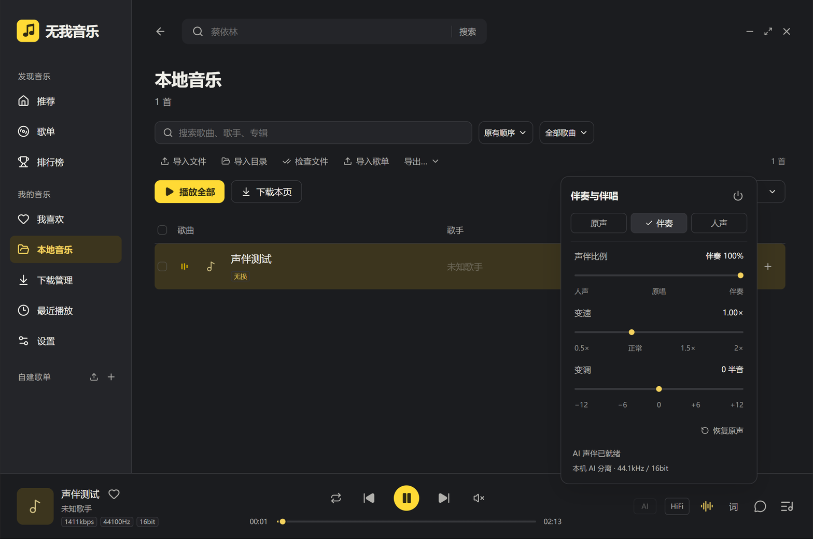

# 无我音乐 1.2.6 验证记录

日期：2026-11-08；系统：Windows 10 x64 10.0.19045；Electron 45.2.3。

本轮解决声伴效果差的问题。研究依据、处理流程、缓存位置和复现命令见 [实现说明](ACCOMPANIMENT-1.2.6.md)。只交付 `win-unpacked`，不制作安装器或单文件便携 EXE。

## 验证结果

| 项目 | 结果与证据 |
|---|---|
| 原因定位 | 旧版左右声道抵消会同时削减中央乐器，单声道几乎全静音；已移除 |
| QQ 只读研究 | 原生模块的声伴混合接口、OpenVINO 模型输入输出与哈希已记录：[JSON](evidence/qq126-inspection.json) |
| 自动化测试 | **123 项通过**，包含原播放／下载测试、声伴混合、文件交错、损坏长度、取消、真实 AI 单声道、缓存和任务替换 |
| 本地完整处理 | 官方演示音频 11.146 秒，从解码到六声道合成约 851ms；记录：[JSON](evidence/separation126-local.json) |
| 真实在线音源 | 免登录搜索“晴天 周杰伦”，取得完整 FLAC 55,397,039 字节，生成 270.095 秒六声道文件，网络获取至完成约 13,999ms：[JSON](evidence/separation126-online.json) |
| Electron 实际 PCM | 原声约 440Hz、人声 660Hz、伴奏 880Hz 三对信号分别输出；1.25× 与 +12 半音同时生效，输出约 1320Hz：[JSON](evidence/effects126-electron.json) |
| 进度和暂停 | 拖动至 3 秒后继续前进；暂停位置漂移为 0；还原原声后位置为 2 秒且保持暂停 |
| 请求竞争 | 切歌忽略旧结果、准备期间暂停、还原原声保持暂停、关闭后忽略迟到结果、换源淡出中切歌、淡出中恢复原声全部通过，同一证据文件的 `races` 字段 |
| 原生 GUI | 使用 cua-driver 在独立资料目录中检查本地导入、播放、首次准备就绪、三个预设、1.25×、+2 半音、缓存再次就绪，以及暂停后还原原声 |
| 构建 | TypeScript、Vite、Electron 主进程构建通过，9 个 AI 二进制／模型组件哈希一致 |

测试中的音频输出使用静音测量或测试资料目录，未改变系统代理、QQ 配置或正式歌曲文件。在线验证的歌曲仅保留在本机测试缓存，不随仓库发布。

GUI 截图：



## 备份与交付

修改前已备份 1.2.5 源码、整个旧版目录与资料文件，位置：

`D:\3DS_MAX\20261107_music\backups\wuwo-before-1.2.6-20261108-171911`

两个既有资料目录都已保留，常用版本实际使用的 `kuwo-desktop` 资料也补充保存在备份中的 `profile-current-kuwo-desktop`。验证使用 E 盘独立资料目录，交付前对比两份正式 `state.json` 的哈希与修改时间，确认未被测试改写。没有从测试目录向正式资料复制设置、队列或歌曲。

最终位置：`release/无我音乐-1.2.6/win-unpacked`。

宿主 D 盘目录权限使自动化启动器不便访问，因此原生 GUI 运行 E 盘副本；交付脚本逐文件比对其与打包目录、最终交付目录的运行文件。完整校验清单为交付目录中的 `SHA256SUMS.txt`，记录见 [交付 JSON](evidence/delivery-1.2.6.json)。

构建时第一次从网络下载 Electron 遇到 HTTP 504，最终使用已由 npm 安装的同版本本地 Electron 完成打包：

```powershell
npm run build
npx electron-builder --win dir --x64 --config.electronDist=node_modules/electron/dist
```

## 本轮未验证和实际边界

- 没有 Windows 11 实机或实体 DAC 验证；HiFi 保持原文件及已有独占输出路径，不经过 AI。
- 不是 QQ 私有模型的复制或其算法质量等价证明。采用可随包分发的 Spleeter 模型，主观听感仍受具体录音影响；未进行参考轨 SDR／SIR 或盲听对照，不将性能测试解释为准确率。
- AI 音轨为 44.1kHz / 16bit，支持 15 分钟以内、512MiB 以内的音源；不是 HiRes 原样输出。恢复原声和下载保持原文件。
- 完成缓存上限为 2GiB，当前正在使用的条目保留；工作期间还需要解码和临时声轨空间。重启后按保存的偏好，在用户主动播放歌曲时准备／复用声伴。
- 原生 GUI 的搜索输入在本次后台桌面无法获得前台焦点，因此没有把在线搜索的 GUI 完整流程记为通过；在线搜索、完整音源获取和分离通过真实 Electron 网络栈独立验证。

复现步骤集中在 [声伴实现说明](ACCOMPANIMENT-1.2.6.md#如何复现)。
