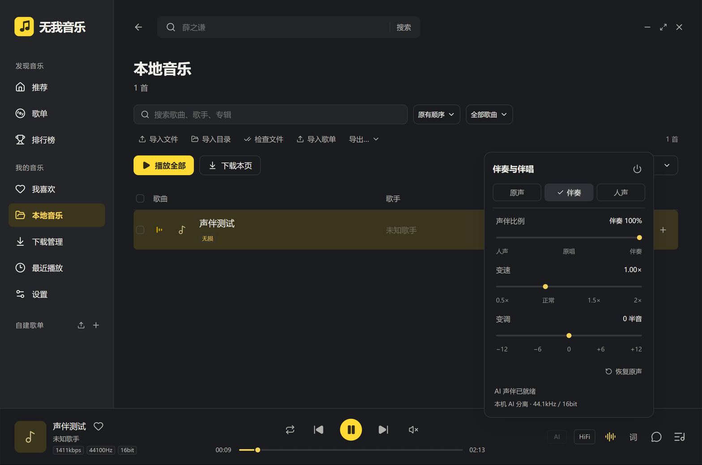

# 无我音乐 1.2.7：中文路径声伴故障修复

2026-11-08，Windows 10 x64 10.0.19045，Electron 45.2.3。

## 原因与改动

用户截图显示声伴引擎失败。检查实际配置，音乐下载目录含“无我音乐”。旧版把缓存 WAV 和模型的完整路径传给原生分离程序；在本机 Windows 上，其窄字符参数／文件读取接口无法识别中文路径，提示文件不存在。旧版只展示退出码、未保存引擎输出，无法单凭截图判断每一次退出的具体原因；本轮对实际目录特征做了可重复的负例和修复验证。

同一份中文路径输入，旧调用失败，原生退出码为 `4294967295`，日志确认无法读取输入；修复调用成功生成音轨。见 [负例／正例记录](evidence/separation127-regression.json)。不是通过隐藏错误或更改用户下载目录解决。

修复方法：

1. Windows 以 Unicode 路径启动引擎，将私有任务目录设为工作目录。
2. 仅向引擎传入 `dry.wav`、`vocals.fp16.onnx` 等英文相对文件名，输入、输出及模型路径均覆盖。
3. 模型同盘优先建立硬链接，跨盘／不支持硬链接时复制到私有任务目录。结束、失败或取消后统一清理，只删除本任务创建的目录。
4. 使用固定随包引擎及模型，不修改歌曲、不更改系统代码页或用户保存目录；缓存格式与旧版兼容。
5. 失败区分“音频解码”和“AI 分离”，保存阶段、退出码及最近 4,000 字符的输出到 `%APPDATA%/kuwo-desktop/logs/separation.log`。日志按 1MiB 轮换，网络地址替换为 `[url]`。

实现位于 `electron/separation.ts`，主进程日志接入在 `electron/main.ts`。AI 模型和混合算法沿用 1.2.6，原理与许可见 [实现说明](ACCOMPANIMENT-1.2.6.md)。

## 实测结果

| 项目 | 结果 |
|---|---|
| 自动化测试 | **125 项通过，0 失败**；新增真实中文安装／缓存／文件名（含空格、符号与 emoji）和失败日志回归 |
| 旧版负例 | 直接给原生程序传入中文绝对路径，复现无法读取文件 |
| 修复正例 | 相同输入经修复后的完整解码、AI、合成链路成功 |
| 用户同曲 | `6878708`《青花瓷》周杰伦，完整 FLAC 26,171,656 字节，生成约 239.630 秒音轨；全流程约 14,162ms |
| 中文安装与跨盘 | 使用 E 盘中文安装目录内的实际随包引擎／模型，D 盘中文缓存目录；复制模型分支通过：[记录](evidence/separation127-online.json) |
| 真实桌面 | cua-driver 操作中文安装目录下的免安装程序，在独立中文资料／下载目录首次完成 AI 准备，切换人声、伴奏及恢复原声均通过 |
| 打包 | TypeScript、Vite、主进程及 Windows x64 目录打包通过；模型和运行组件哈希检查通过 |



桌面验证使用静音、独立资料目录。未向正式资料复制测试设置、队列或歌曲，未关闭用户正在使用的旧窗口。GUI 使用 E 盘副本，交付时逐文件比较副本、打包结果与最终目录。

## 复现

```powershell
npm ci
npm test
npx tsx scripts/verify-unicode-separation127.ts
npm run package:dir
```

将整个 `win-unpacked` 复制到中文路径，例如 `E:/无我音乐 验证127/win-unpacked`，保留全部文件。下面的网络验证会把歌曲暂存在项目 `artifacts` 下，不写正式资料：

```powershell
$env:WUWO127_RUNTIME='E:/无我音乐 验证127/win-unpacked'
npx esbuild scripts/verify-online-separation127-electron.ts --bundle --platform=node --format=cjs --external:electron --outfile=artifacts/online127.cjs
& node_modules/electron/dist/electron.exe --user-data-dir="$PWD/artifacts/network127-profile" artifacts/online127.cjs
```

网络脚本按截图对应的固定歌曲 ID 解析音源，不依赖搜索排序。网络响应和处理耗时可能变化；记录不包含临时音频地址。

## 备份、交付与范围

修改前备份源码、1.2.6 整个免安装目录及正式设置，位置：

`D:/3DS_MAX/20261107_music/backups/wuwo-before-1.2.7-20261108-183201`

本次只交付 `release/无我音乐-1.2.7/win-unpacked`，包含校验文件与验证记录。关闭旧程序后启动新版 EXE；资料和下载目录继续沿用。

Windows 11 和实体 DAC 本轮未测试。声伴支持范围、44.1kHz / 16bit 输出与 HiFi 旁路保持原设计；此次修复不代表所有歌曲的主观分离效果均已验证。
